# HookRank

**Finds the best promo clips in microdrama screenplays.**

A promo is a 20–60 second clip that **opens on a hook** in the first 3 seconds, **ends on a cliffhanger**, and **makes sense to someone who has never seen the show**. Give HookRank a show's screenplays and it returns a ranked shortlist. For each promo it gives the exact episode and timestamps, the hook, the cliffhanger, why it works, and why it ranks where it does.

---

## 1. Setup

### Option A: use the web app (nothing to install)

**👉 [Open HookRank](https://shareappioutmsourcechatgptcom-2c7jfxrbyqc8uorcbrwbdt.streamlit.app/)**

1. **Upload** a ZIP of episodes, or one or more `.txt` screenplays.
2. Click **Analyze**. A 50-episode show takes about 2 minutes.
3. **Click any row** in the Top 10 table to see the hook, the cliffhanger, why it works, and the script excerpt.
4. Click **Download CSV** or **Download JSON** to keep the results.

If the app has been idle, it first shows a *wake up* button. Click it and wait about a minute.

### Option B: run it on your computer

You need Python 3.12 or newer.

```bash
git clone https://github.com/AnshG12/hookrank.git
cd hookrank
python3 -m venv .venv && source .venv/bin/activate
pip install -r requirements.txt
cp .env.example .env          # then add your API key to .env (see "API setup" below)
```

Put your screenplays (`.txt` files) in a folder, for example `scripts/`, and run:

```bash
python main.py run --input scripts --series-id my-show --output-dir outputs/my-show
```

The report is in **`outputs/my-show/promos_report.md`**, and the same results are in `promos_ranked.csv` and `.json`.

Other useful commands:

| Command | What it does |
|---|---|
| `python main.py doctor` | Checks that your API key and models work |
| `python main.py run ... --episodes 1,2,3` | Analyse only some episodes |
| `python main.py spend` | Shows how much has been spent |
| `streamlit run streamlit_app.py` | Runs the web app on your computer |

### API setup

**Right now HookRank runs on [Nebius Token Factory](https://tokenfactory.nebius.com) with two models:**

| Model | Its job |
|---|---|
| `openai/gpt-oss-120b` | Reads each episode's story, labels the scenes, and checks the final clips |
| `Qwen/Qwen3-235B-A22B-Instruct-2507` | Labels the scenes too, as a second, independent opinion |

All you need is one key:

```toml
NEBIUS_API_KEY = "..."
```

**Want to use a different AI?** HookRank also supports the providers below. Add the key for the one you want:

| Provider | Key |
|---|---|
| Claude (Anthropic) | `ANTHROPIC_API_KEY` |
| GPT (OpenAI) | `OPENAI_API_KEY` |
| Gemini (Google) | `GEMINI_API_KEY` |
| OpenRouter (hundreds of models with one key) | `OPENROUTER_API_KEY` |
| Your own API (any OpenAI-compatible endpoint) | `MYAPI_BASE_URL` and `MYAPI_API_KEY` |

Then say which model does which job, and add prices (dollars per million tokens, input/output) for GPT, Gemini or your own API:

```toml
ANTHROPIC_API_KEY = "..."
OPENAI_API_KEY    = "..."
GEMINI_API_KEY    = "..."
HOOKRANK_STORY_MODEL      = "anthropic:claude-opus-5-5"
HOOKRANK_ANNOTATOR_MODELS = "openai:<gpt-model>,gemini:<gemini-model>"
HOOKRANK_PRICES = "<gpt-model>=1.25/10, <gemini-model>=0.30/2.50"
```

**Where to put these lines**
- **Web app:** [share.streamlit.io](https://share.streamlit.io), then your app → **⋮ → Settings → Secrets** → paste → **Save**.
- **Your computer:** in the `.env` file, written as `KEY=value`.

**Good to know**
- **Fallback:** anything you don't set, or set without a key, keeps using Nebius.
- **Cost limit:** stronger models cost more. In the web app, raise the limit per analysis with `HOOKRANK_RUN_BUDGET_USD = "5.00"` (the default is $0.50).
- **Keys stay private:** they stay on the server and are never shown on the page.

---

## 2. Architecture

> **AI reads the story, code makes the promos.**

```mermaid
flowchart LR
    S[/"🎬 Screenplays"/]:::data --> P["Parse<br/>timed events"]:::code --> U["Understand<br/>story and scene labels"]:::ai --> V["Verify<br/>every quote"]:::code
    V --> B["Build and score<br/>every legal cut"]:::code --> C["Clip check<br/>classify the clip"]:::ai --> R["Decide and rank"]:::code --> O[/"📋 Shortlist"/]:::data --> H(["👤 Editor"]):::human

    classDef ai fill:#ede9fe,stroke:#6d28d9,color:#2e1065,stroke-width:2px
    classDef code fill:#e0f2fe,stroke:#0369a1,color:#082f49,stroke-width:2px
    classDef data fill:#f1f5f9,stroke:#64748b,color:#0f172a
    classDef human fill:#dcfce7,stroke:#15803d,color:#052e16,stroke-width:2px
```



- **🟣 AI:** works out who is who and labels what happens in each scene (a reveal, a threat, an open question…). Every label must quote the script word for word. The AI never scores promos.
- **🔵 Code:** decides everything that must be exact: where a clip may be cut, the hook within the first 3 seconds, the 20–60 second length, and the scoring and ranking.
- **🔍 Clip check:** the AI sees only the finished clip and describes how it opens and ends. Code then rejects weak openings and endings that give the answer away.
- **👤 Editor:** picks from the shortlist. HookRank never posts anything by itself.
- **Cost:** about $0.20 and 2 minutes for a 50-episode show.

- 📐 **The full design, with diagrams of every stage:** [docs/architecture.md](docs/architecture.md)
- ✅ **How we know the output is good, and where it fails:** [docs/quality.md](docs/quality.md)
- 📒 **Every decision and experiment:** [docs/decisions.md](docs/decisions.md)

---

## What you get

| File | Contents |
|---|---|
| `promos_report.md` | The readable report: top promos with timestamps, hook, cliffhanger, why it works and why it ranks there; the best promo per episode; rejected cuts with reasons |
| `promos_ranked.csv` / `.json` | The ranked "post first" list |
| `promos_by_episode.json` | The best promo for each episode |

## Known limits

- **Script time:** timestamps are script time; the edited video may differ.
- **Text only:** it reads text, so it can't judge acting, visuals or sound.
- **Provisional scoring:** the scoring weights are reasoned assumptions; no editor data exists yet to tune them.
- **Imperfect clip check:** it sometimes misjudges an ending.
- **One template:** only the studio's screenplay template is supported.

The full quality review (real runs, before/after results, honest failures, and the quality ablation we didn't have time to run) is in **[docs/quality.md](docs/quality.md)**.
