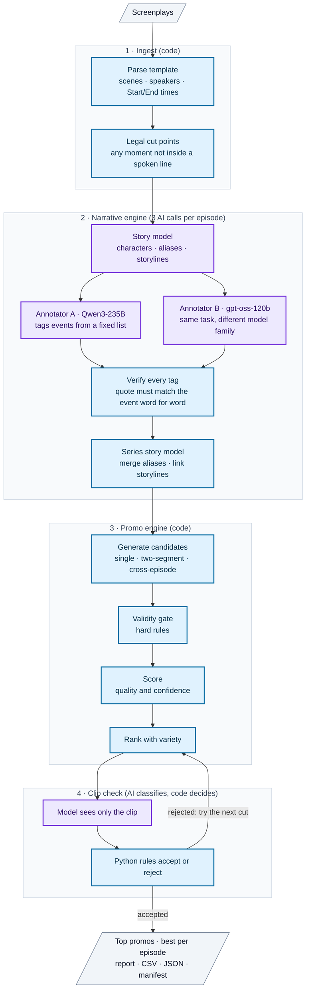
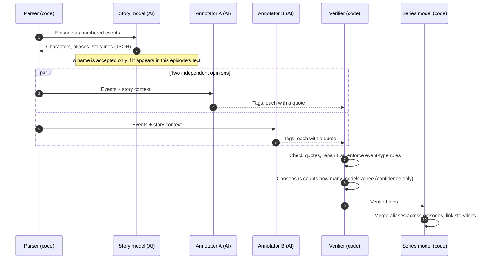
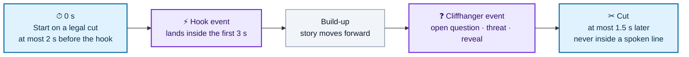
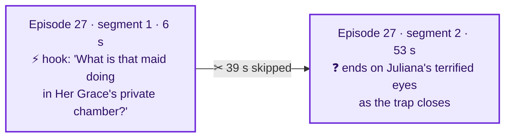
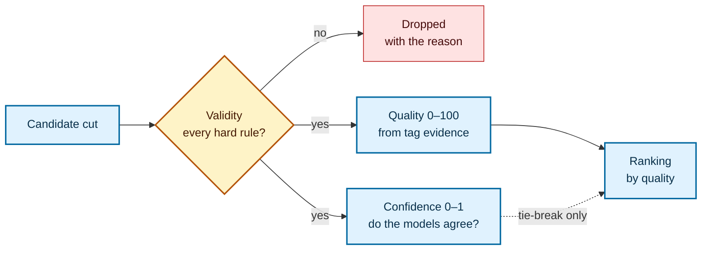
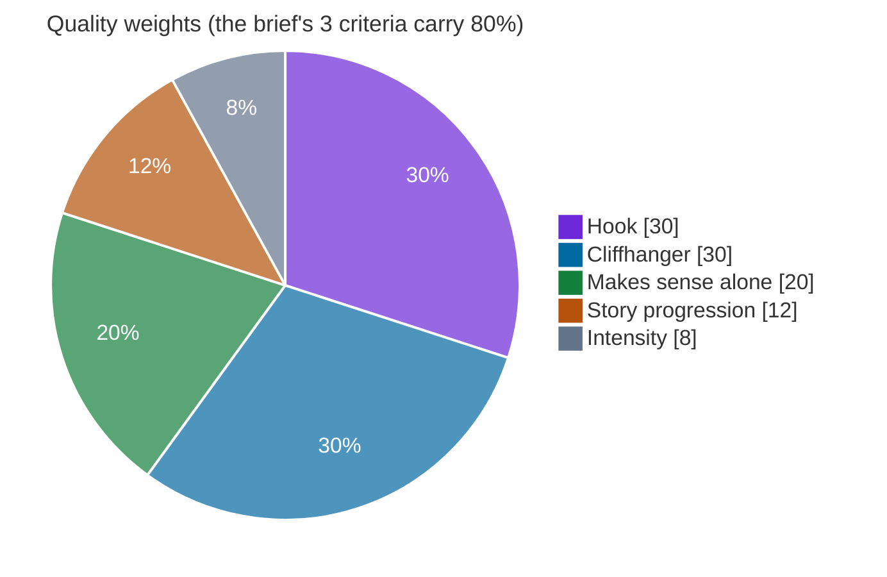
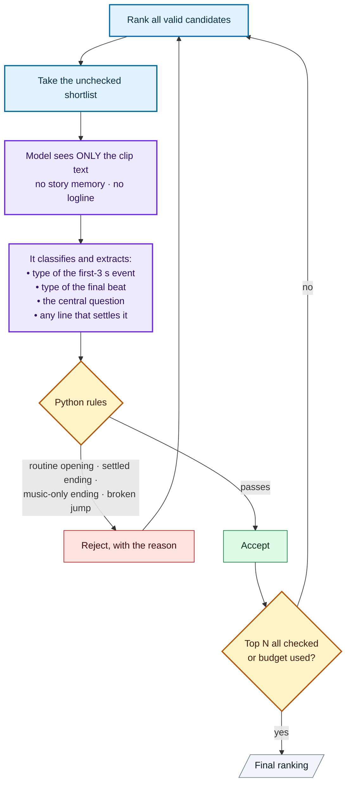
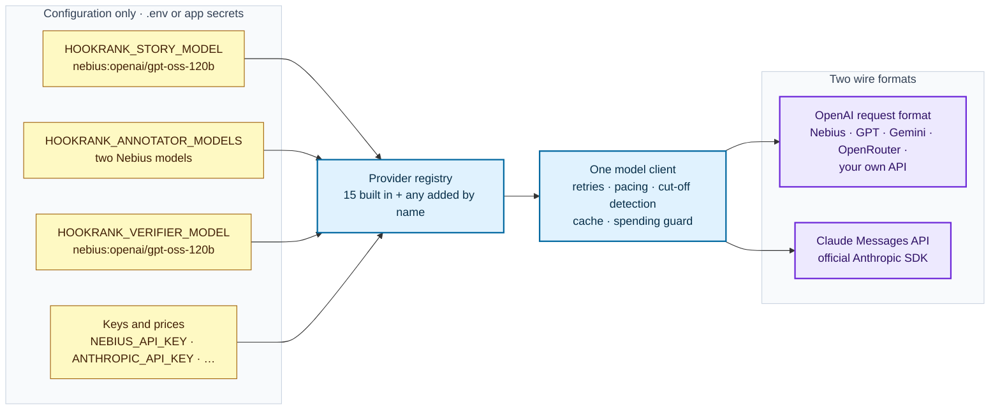
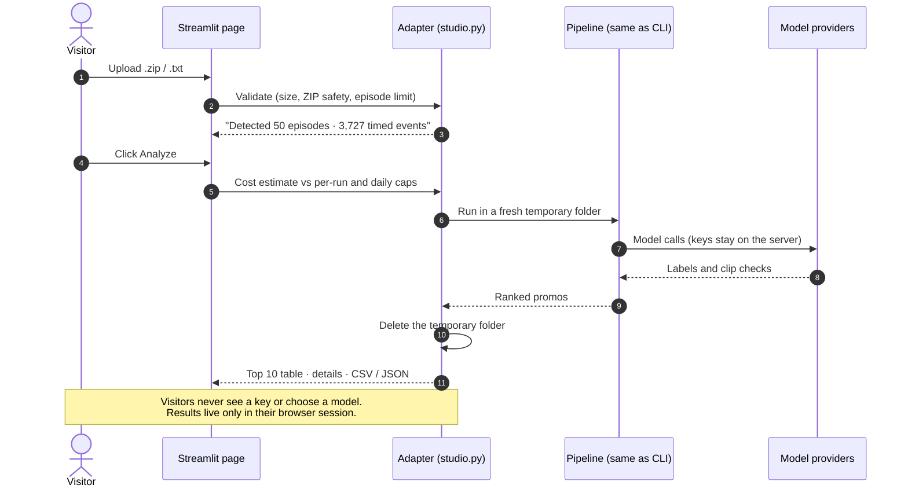

# HookRank architecture

> **The one idea:** AI reads the story, code makes the promos.
> Models only *describe* what happens in each scene. Python decides every timestamp, applies every rule and ranks the promos, so every answer traces back to a line in the script.

**Contents**
1. [The big picture](#1-the-big-picture)
2. [The pipeline, stage by stage](#2-the-pipeline-stage-by-stage)
3. [One episode through the narrative engine](#3-one-episode-through-the-narrative-engine)
4. [How a promo is cut](#4-how-a-promo-is-cut)
5. [Three separate scores](#5-three-separate-scores)
6. [The clip check and selection rounds](#6-the-clip-check-and-selection-rounds)
7. [Swappable models](#7-swappable-models)
8. [The web app and its safety boundary](#8-the-web-app-and-its-safety-boundary)
9. [Scale and cost](#9-scale-and-cost)
10. [Code map](#10-code-map)

---

## 1. The big picture

| Colour | Who | Does what | Why |
|---|---|---|---|
| 🟣 Purple | **AI** | Judgements text rules can't make: who is who, what is shocking, what is still unresolved | That's the part that needs language understanding |
| 🔵 Blue | **Code** | Timing, cut points, the 3 s and 20–60 s rules, validity, scoring, ranking | A model can't be trusted with exact timestamps, and the rules must hold every time |
| 🟢 Green | **Human** | Picks from the shortlist and cuts the video | No editor or audience data exists yet, so the tool never posts by itself |

**What the models are never asked:** "Is this a good promo?" When we tried that kind of question, models answered "yes" to 23 of 24 clips (experiment S7), so it carries no information.

---

## 2. The pipeline, stage by stage

| Stage | Key rule | Why |
|---|---|---|
| Parse | Fails loudly on an unknown template instead of returning nothing | A silent empty result looks like "no good promos" |
| Story model | One call per episode; episodes run in parallel and are cached separately | An edited episode re-runs only itself |
| Annotators | Two different model families; **tags only, no scores** | Self-reported scores just restated rank order (S1); two families give an independent second opinion |
| Verify | A tag whose quote belongs to a neighbouring event is moved there; a quote found nowhere drops the tag | Models sometimes cite the wrong event ID |
| Event-type rules | "Physical action" and "striking visual" need a visible event; "shocking line" needs dialogue | Stops a sound effect being called a slap |
| Series model | Aliases merged ("Lady in Gold Gown" = Clarissa); storylines linked only when they share 2+ characters | A shared protagonist alone must not merge two plots |

**The 14 event tags:**
- Narrative: `betrayal` `new_conflict` `escalation` `reversal` `reveal` `open_question` `resolution`
- Attention: `physical_action` `shocking_line` `threat` `confrontation` `humiliation` `emotional_shift` `striking_visual`

---

## 3. One episode through the narrative engine

- **Cut-off answers are never trusted.** If a model runs out of output tokens, the episode is re-annotated in smaller windows of events.
- **Every response is cached** under a key that covers the model, its parameters and the full prompt. Re-runs are free and an interrupted run resumes where it stopped.

---

## 4. How a promo is cut

**Hard rules (every promo, checked by code):**
- 20–60 seconds in total, with at most 2 segments.
- Never cut inside a spoken line.
- The hook starts within 2 s; the cut is within 1.5 s of the cliffhanger.
- Nothing is resolved in the final 6 s. An event tagged `resolution` can never be the cliffhanger.

**When two segments are joined:**

A promo is joined from two segments only to:
- connect a strong hook to a cliffhanger more than 60 s away;
- skip a resolution that a continuous clip would include;
- bridge to one of the next two episodes on a shared storyline.

The two segments must share a storyline or a character. The example above is the #1 promo of the final 50-episode run.

---

## 5. Three separate scores

- **Validity** is pass/fail. Only valid promos are ranked.
- **Quality** comes from tag evidence only. "Makes sense alone" is penalised by context needed from earlier episodes, a crowded cast, names mentioned but never shown, and extra segments.
- **Confidence** reflects agreement, repaired IDs and parse warnings. It is shown beside quality and **never replaces it**: models agreeing is not proof of quality.
- **Variety:** each promo already picked from the same episode lowers a candidate by 10%, and from the same storyline by 4%. Near-duplicates (same hook, same cliffhanger, or more than 50% overlap) are skipped.
- The weights are **stated assumptions, not fitted values**. No editor labels exist yet, and editor choices are the data that would fit them.

---

## 6. The clip check and selection rounds

- **Why "classify, don't judge":** the verdict version passed nearly everything. The classify version passed all 6 strong test cuts and caught 3 of the 4 clearly weak ones (S7).
- **A failed check doesn't hide the clip:** a failed opening or ending scales that score by 0.4, and the reason appears in the report.
- **Budgets:** up to 40 checks in the web app and 80 on the command line, so the cost stays bounded.
- **Known weakness:** the checker sometimes treats a twist as a "resolution" and can judge near-identical cuts differently. See *Where it picks badly* in the solution doc.

---

## 7. Swappable models

- **Swapping a model is a configuration change.** Set the provider's key and point a role at `provider:model`. No code changes.
- **Nebius is the default.** A role whose provider has no key falls back to its Nebius model.
- **Any OpenAI-compatible API** can be added with `<NAME>_BASE_URL` and `<NAME>_API_KEY`.
- **Spending is guarded before any call is sent.** Every paid call reserves its worst-case cost first, and a paid model with no known price is refused.
  - Prices come from Nebius's and OpenRouter's catalogues, a built-in Claude list, or `HOOKRANK_PRICES`.
- **Parameters a model doesn't accept** (for example temperature on reasoning models) are dropped and the request retried, instead of hard-coding rules per model.

---

## 8. The web app and its safety boundary

| Protection | How |
|---|---|
| Keys stay secret | Read on the server from secrets; never rendered, logged or exported (tested) |
| Spend is bounded | Hard cap per run ($0.50 default) · daily cap for the app · one analysis at a time · upload limits |
| Uploads are safe | ZIP traversal, ZIP bombs and encrypted entries are rejected; names are sanitised |
| Nothing is kept | Each run gets its own temporary folder, deleted at the end; no data is shared between sessions |

---

## 9. Scale and cost

**Measured on the full 50-episode pack:**

| | |
|---|---|
| Model calls | 3 per episode + up to 40–80 clip checks (240 in total) |
| Candidate cuts scored | 11,398, by code, at no model cost |
| Time | ≈ 2 minutes (Nebius, parallel requests) |
| Cost | ≈ $0.19–0.20 per 50-episode show |
| Re-run of unchanged episodes | free (cached) |

- **Cost grows with episodes, not with candidates.** About 100 new 50-episode shows a week would cost about $20.
- **What changes for a fleet of machines:**
  - a parser adapter for each new screenplay format;
  - a shared database instead of the local SQLite cache and spend ledger;
  - provider rate limits;
  - aligning script time to the edited video.

---

## 10. Code map

| Area | Files |
|---|---|
| Entry points | `main.py` (CLI) · `streamlit_app.py` (web page) · `hookrank/studio.py` (web adapter) · `hookrank/run.py` (one pipeline for both) |
| Parsing | `hookrank/parsing.py` · `hookrank/schemas.py` |
| Narrative engine | `hookrank/narrative/` (`extraction.py` story · `annotation.py` tags · `consensus.py` · `story.py` series model · `vocab.py` the 14 tags) |
| Promo engine | `hookrank/promos/` (`generate.py` cuts · `scoring.py` weights · `rank.py` · `verify.py` clip check) · report written in `hookrank/run.py` |
| Models | `hookrank/config.py` providers and roles · `hookrank/llm.py` client · `hookrank/calls.py` cached calls · `hookrank/budget.py` spending guard · `hookrank/cache.py` |
| Prompts | `prompts/narrative_story.md` · `prompts/narrative_annotate.md` · `prompts/clip_check.md` |
| Evidence | `docs/decisions.md`: every decision, experiment and trade-off |
